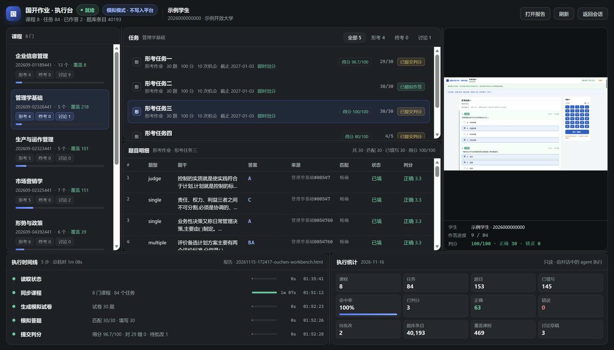

# 国开作业工作台 · DeepSeek Harness 插件

在 DeepSeek Harness 左侧「工作台」里打开的一整页执行台：同步国开学习平台的课程与作业，
用本地答案库（或 AI 答案）**真实作答并交卷**，同时保留原有的模拟作答与判分作为对照。



## 两种模式

| 模式 | 工具 | 写平台吗 | 用途 |
|---|---|---|---|
| 模拟 | `ouch_exam` / `ouch_solve` / `ouch_submit` | 不写 | 只读同步 + 本地模拟试卷，用来看题库覆盖率、练流程 |
| 真实 | `ouch_real` / `ouch_run` | **写** | 进入真实考试、读真实试题、填写、回读校验、交卷、读平台判分；在讨论区发帖；播放视频补完成度 |

真实模式的底线：**只有每一道题都拿到答案（并且回读确认填上）才会交卷**；题库没覆盖的题会
返回 `needs-answers` 和题目清单，由 agent 补答案后再跑。

## 装到另一台电脑

### 方式一：插件页面（推荐）

1. 打开 DeepSeek Harness，左侧点 **插件** → 右上角 **Add plugin**；
2. 在输入框粘贴 `github:15819913214/dsh-ouchn-workbench`，确定；
3. 等它下载安装完成，刷新页面；
4. 左侧点「工作台」→「国开作业」，执行台就出来了。

### 方式二：直接让 agent 装

在对话里说：

```
安装插件 github:15819913214/dsh-ouchn-workbench
```

装完重启一次 Harness，让 `ouch_*` 工具生效。

## 第一次怎么用

1. 对话里说：**「登录国开，学号 xxx，密码 xxx」**；
2. 再说：**「同步全部课程」**；
3. 想看某次作业：**「模拟作答《管理学基础》形考任务一」**；
4. 想要报告：**「生成执行报告」**。

账号密码不需要写进任何文件，agent 会直接传给登录工具。
想省掉每次输入，可以设置两个环境变量 `OUCHN_ACCOUNT`、`OUCHN_PASSWORD`（系统环境变量，重启 Harness 后生效）。

## 题库：仓库只带 3 门示例课

完整题库（469 门课 / 4 万题）来自个人作业资料，**不放进公开仓库**。
所以新电脑刚装好时，只有这三门课能出卷：**管理学基础、市场营销学、形势与政策**。

补全题库，二选一：

### A. 拷贝（最省事）

1. 在已经有题库的电脑上打开这个文件夹：

   ```
   C:\Users\<你的用户名>\.dsh\profiles\desktop\node_modules\dsh-workbench\data
   ```

   （如果 `dsh-workbench` 是个快捷方式，右键 → 属性 → 看「目标」，进到真实目录里的 `data`）

2. 把整个 `data` 文件夹复制到 U 盘；
3. 在新电脑上找到同样的路径，用 U 盘里的 `data` 覆盖它；
4. 重启 DeepSeek Harness。

> 更稳的办法：把 `data` 放到一个固定位置（比如 `D:\ouchn-data`），然后在插件配置里加一行
> `dataDir: 'D:\ouchn-data'`。插件升级时不会动这个目录，题库一直作数。

### B. 重建（有参考软件的数据库时）

题库是用参考软件已经解析好的 `homework.db` 导出的：

```powershell
# 在插件目录里执行（需要 Python 3.11+）
python tools/build-answers.py --db "C:\...\HomeworkCopilot\data\homework.db" --out "D:\ouchn-data"
```

跑完把 `dataDir` 指向 `D:\ouchn-data` 即可。整库约 15 MB，469 门课。

## 页面

| 区域 | 内容 |
|---|---|
| 顶部左 | 学生、运行状态、课程/任务/正常/异常计数；顶部右是**开始执行自动化 / 暂停 / 继续 / 停止 / 退出账号 / 刷新 / 打开日志 / 同步 GitHub / 返回会话** |
| 左栏 | 真实课程与形考/终考/讨论条数、答案库覆盖、平台学习进度 |
| 中栏 | 任务（题数、总分、作答次数、截止、出分方式、平台状态）＋逐题明细 |
| 右栏上 | 平台实时画面：自适应铺满可用区域，自动化过程中按「当前科目 → 当前作业 → 当前题号」刷新 |
| 右栏下 | **作业统计**：科目总数 / 作业数量 / 正常 / 异常，四个数字里后三个可点开明细，按形考·终考·讨论分类；正常附分数（未出分标「未改分」、教师评阅项标「无需做作业」），异常附原因 |

统计口径：**只有「未完成作答」和「分数不够（<60）」算异常**；`homework` 与 `page` 类型属于平台不要求学生提交的作业，归到「无需做作业」。

所有分区之间都可以拖动调整大小，布局记在浏览器里，下次打开还是你调好的样子。

## 账号与一键执行

- **登录**：未登录时面板中央是登录卡片（学号 + 密码），`POST /ouch/login` 登录后自动同步一次课程与作业；账号密码只在本次浏览器会话里用，不写进仓库。
- **退出**：`POST /ouch/logout` 清浏览器 Cookie、回到平台登录页、清空面板数据（保留本地答案库与缺陷记录）。
- **一键执行**：`POST /ouch/auto` 的 `start/pause/resume/stop`。后台按任务逐个跑，交卷前仍要求每题都有答案；暂停在任务之间和每 4 道题的填题循环里生效。

## 判分口径

- **模拟判分**（默认）：客观题用页面作答与题库答案逐题比对，对得该题分、错记 0；填空/简答/论述记「待批改」。
  总分按任务真实总分算，所以 30 题 100 分的卷子会是 `96.7/100 · 待批改 1`。
- **平台判分**：真实作业交卷后，把平台返回的逐题分数按 `[{seq, score, max}]` 传给 `ouch_submit`，
  就以平台结果为准。此时「平台没给分、题库里却有答案」的题会标红并写进 `suspect`——通常是题库答案不对。

## 工具

| 工具 | 作用 |
|---|---|
| `ouch_open` / `ouch_page` / `ouch_act` | 执行台浏览器的打开、读取（含完整 `eval`）、动作序列 |
| `ouch_login` | 登录国开统一身份认证 |
| `ouch_sync` | 只读同步课程与形考/终考/讨论 |
| `ouch_exam` | 生成并打开模拟试卷 |
| `ouch_solve` | 读题 → 匹配 → 映射 → 填写 → 回读 |
| `ouch_submit` | 提交判分（可传平台逐题分数） |
| `ouch_discussion` | 生成讨论发言草稿（不发布） |
| `ouch_library` | 答案库统计 / 按课程查题量 / 按题干试匹配 |
| `ouch_real` | 真实写入：`open` 看任务状态、`read` 读真实试题、`answers` 存 AI/人工答案、`run` 作答并交卷、`video` 刷视频解锁、`discussion` 发帖 |
| `ouch_run` | 批量跑真实作业：按课程/阶段筛选，逐题有答案才交卷，受阻/缺答案只记录 |
| `ouch_state` | 读执行台状态与任务 id |
| `ouch_report` | 生成 HTML + CSV 报告 |
| `ouch_close` | 关闭执行台浏览器 |

## 边界

- 真实模式会创建答题记录、交卷、发帖——这是它的功能，不是副作用；跑之前确认账号和课程范围；
- **不漏题**：只要有一道题没有答案就不交卷，返回 `needs-answers` 让 agent 补；
- 视频前置：`tryUnlock` 先走平台自己的「已看完」完成标记——对每门课的音视频活动 `POST /api/course/activities-read/{id}`，请求体
  `{"activity_id": id, "activity_type": "learning_activity", "completeness": "full"}`，
  平台会把记录的 `completeness` 从 `part` 翻成 `full`，前置条件随即解除；倍速/拖进度不会被计入完成度，只在接口失败时兜底真播；
- 平台限制类情况（未分配、已截止、需教师批改、需手机端口语）只记录原因，不强行提交；
- 题目来自本地答案库 + 人工/AI 答案，不是实时题库；覆盖不到的题会列出来；
- 登录遇到验证码/滑块会明确报错，不尝试绕过。

## 面板与开发

- **重启后第一下就要能看到**：面板路由以前只在插件加载那一刻 `ctx.get('webServer')` 拿到服务时才注册；DSH 重启时 `webServer` 常常比插件晚一步就绪，于是工具能注册、面板路由全 404，表现就是「点插件没反应、要手动刷新」。
  现在路由注册改成 `ctx.inject(['webServer'], …)` + 400ms 轮询兜底，服务一就绪就补注册；`/ouch/state` 第一次被轮询时会自己 `hydrate()`，所以重启后不需要先跑一次对话工具才有数据。
- **渲染兜底**：面板包了一层错误边界，渲染异常会显示可读的错误卡片和「重新加载 / 重试渲染」，不再整页空白。
- **热更新**：`client.js` 的 mtime/size 变化会被 `@deepseek-ai/dsh-client-hmr` 轮询到，已打开的页面会直接热替换模块；面板另外每 4 秒比一次 `/ouch/ui-stamp`，作为 HMR 未送达时的兜底自动重载。
  想看热更新到底有没有发生，看 `.ouch/client-boots.jsonl`：模块每被浏览器执行一次就落一行 `build` 戳。
- **离线自检**：`node tools/route-check.mjs`（模拟 webServer 晚就绪，断言 11 条面板路由都注册且不重复）、`node tools/render-console.mjs`（用 react-dom/server 真渲染统计面板、登录卡片、弹窗和首屏）。
- **同步 GitHub**：面板右上角「同步 GitHub」按钮 → `POST /ouch/push`，Host 在本机执行 `git add -A / commit / push origin HEAD`；
  只接受 `127.0.0.1`/`::1` 调用，插件不保存任何 token，用的是这台机器已配置好的 git 凭据。没有改动时只做 `git push` 确认同步。

## 开发

```
index.js              Host：注册 ouch_* 工具与 /ouch/* 路由
client.js             Client：整页执行台
src/service.js        状态机、工具实现、持久化
src/browser.js CDP 浏览器桥（含整卷批量填写）
src/lms.js            登录、课程列表、阶段活动解析
src/answers.js        答案库加载、归一化、模糊匹配、选项映射
src/mock.js           模拟试卷生成与页面渲染
src/report.js         HTML / CSV 报告
data/                 答案库（示例 3 门课）
tools/                构建与自检脚本
```

```powershell
node tools/smoke-answers.mjs   # 答案库匹配自检（离线）
node tools/smoke-e2e.mjs       # 端到端：登录→同步→出卷→作答→判分→报告
node tools/preview-server.mjs  # 用真实组件渲染执行台预览
```

## 许可

代码 MIT（见 `LICENSE`）。`data/` 下的示例题解来自课程学习资料，仅供演示匹配与判分流程，不在 MIT 授权范围内。
