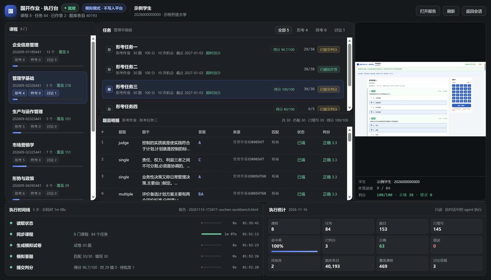

# OUCHN homework console



## What it does

- Signs in with the configured account and reads the student's name and school;
- Syncs "我的课程" read-only and parses each course's 形考/终考/讨论 activities (title, question count, points, weight, deadline, attempts, scoring mode, availability);
- Matches the course against the local answer library (469 courses, 40k questions) and builds a **local simulated paper**: the real question count, option order shuffled;
- Lets the agent answer that paper: read → match → map option text → click/fill → read back;
- Grades the paper per question after submit: objective questions show correct/wrong (wrong is red and points at a suspect library answer), subjective ones stay pending review, and the task shows its score;
- Drafts a discussion post for discussion tasks;
- Writes a single-file HTML report and a per-question CSV.

## Panel

The console is made of draggable panes — courses, tasks and questions, the live platform frame, and the bottom stats/timeline split. Drag any divider; the layout is remembered.

## Boundaries

- The platform side is **read-only**: no attempt is created, no draft saved, nothing submitted, no post published, no score written;
- Questions come from the local answer library, not from a live quiz page; a miss is reported as 未命中;
- Discussions are drafted, never posted;
- A captcha or slider requiring a human is reported as a tool error.

## Usage

Ask in chat:

```
Sign in to OUCHN and sync every course
```

```
Simulate 管理学基础 · 形考任务一
```

```
Draft the discussion posts for 管理学基础
```

```
Generate the run report
```

## Data and files

- Answer library: `data/library.json` and `data/answers/<course>.jsonl`, exported by `tools/build-answers.py`;
- Run state: `<session workdir>/.ouch/state.json`;
- Browser profile: `<session workdir>/.ouch/profile` (login is not persistent; each new process signs in once);
- Reports: `<session workdir>/reports/`.
