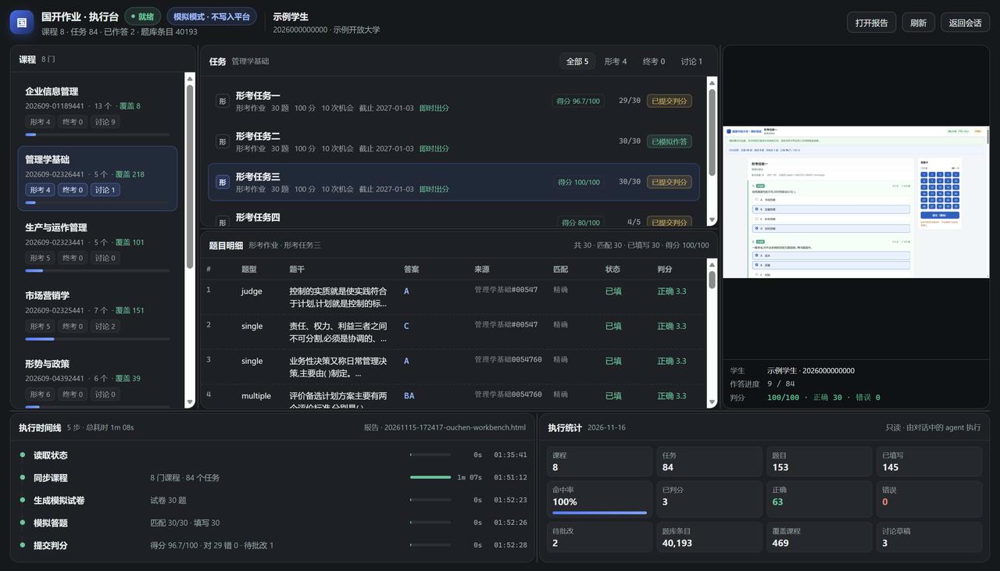

# 国开作业执行台



## 它能做什么

- 用配置的账号登录国开统一身份认证，读出学生姓名与学校；
- 只读同步「我的课程」，逐门课解析形考作业、终考作业、讨论题（标题、题数、总分、权重、截止、作答次数、出分方式、可执行性）；
- 按课程名匹配本地答案库（469 门课、4 万道题），为任务生成一份**本地模拟试卷**：题数取任务真实题数，选项顺序被打乱；
- 让 agent 在模拟试卷上逐题作答：读题 → 答案库匹配 → 选项文本映射 → 点选/填写 → 回读校验；
- 交卷后逐题判分：客观题给正确/错误（错误标红，提示题库答案可能不符），主观题记「待批改」，任务上显示得分；
- 为讨论题生成发言草稿；
- 输出单文件 HTML 报告与逐题 CSV。

## 页面

整页执行台由若干可拖动分区组成：左栏课程、中栏任务与题目明细、右栏平台实时画面、底部执行统计与执行时间线。每个分区之间的细线都能拖，调整结果会记住。

## 边界

- 平台端**只读**：不创建答题记录、不保存草稿、不交卷、不发帖、不改成绩；
- 题目来自本地答案库，不是平台题库的实时抓取；命中不了就如实标「未命中」；
- 讨论只生成草稿，不发布；
- 登录需要人工过验证码/滑块时会在工具结果里明确报错。

## 怎么用

在对话里让我执行，例如：

```
登录国开平台并同步全部课程
```

```
把《管理学基础》的形考任务一模拟作答一遍
```

```
再为《管理学基础》的讨论题各写一份草稿
```

```
生成本次执行报告
```

每次执行都会写入底部时间线；右栏的平台画面是插件的 Edge 窗口实时截取的。

## 数据与文件

- 答案库：`data/library.json` + `data/answers/<课程>.jsonl`，由 `tools/build-answers.py` 从参考软件的解析结果导出；
- 运行状态：`<会话工作目录>/.ouch/state.json`（重开面板会接着上次的数据）；
- 浏览器配置：`<会话工作目录>/.ouch/profile`（登录态不持久，每次新进程重新登录一次）；
- 报告：`<会话工作目录>/reports/`。
